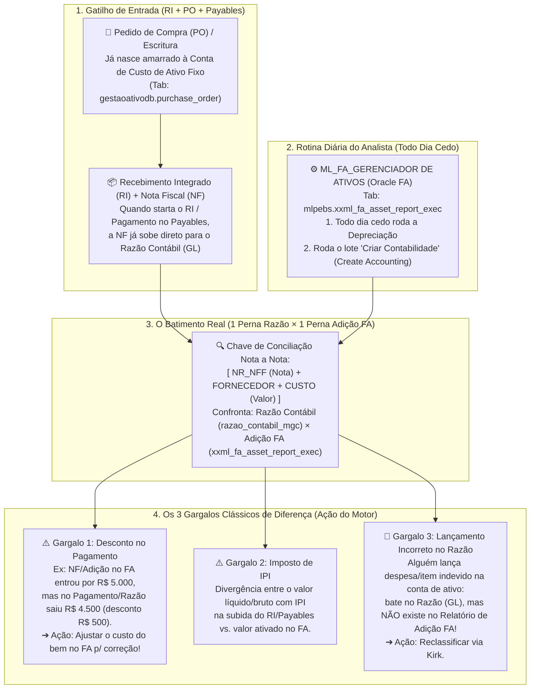

# Frente 02: Gestão de Ativos (Contrato Canônico `mlpebs` — Manual Oficial + Ida a Campo Mesa do Analista + Dados Reais `maga-bigdata`)

> **Termômetro de Maturidade no Motor:** 🟢 **`100% Pronto p/ Desenvolver`** *(Incorporado o Manual Oficial de Contas + Levantamento presencial na mesa do analista + Auditoria completa no BigQuery `maga-bigdata` em 17/11/2026! Localizada a tabela oficial do `ML_FA_GERENCIADOR DE ATIVOS` (`maga-bigdata.mlpebs.xxml_fa_asset_report_exec` com `NR_NFF`, `FORNECEDOR`, `NR_PO`, `PATRIMONIO`, `CUSTO`, `DEPRECIACAO_MES`, `DEPRECIACAO_ACUMULADA`, `VIDA_UTIL`, `ATIVO_CONTA`, `DESPESA_CONTA`), as 75 tabelas do portal `maga-bigdata.gestaoativodb.*` e o catálogo completo das 20+ contas contábeis de Ativo Fixo e Intangível somando mais de R$ 6,1 bilhões em custo ativado).*

---

## 1. Descoberta no BigQuery (`maga-bigdata`): As Tabelas Oficiais do Oracle FA & Gestão de Ativos

Consultamos diretamente o ambiente corporativo **`maga-bigdata`** e encontramos **100% das informações que o analista usa na mesa**, já replicadas do Oracle EBS (`mlpebs`) e do Portal de Gestão de Ativos (`gestaoativodb`):

### 1.1. Tabela Oficial do `ML_FA_GERENCIADOR DE ATIVOS`: `maga-bigdata.mlpebs.xxml_fa_asset_report_exec`
Esta tabela é a **extração oficial do Gerenciador de Ativos do Oracle Fixed Assets (`FA`)** e já traz, **bem a bem e nota a nota**, todos os campos que o analista usa para conciliar com o Razão:

| Grupo de Informação | Colunas Reais em `maga-bigdata.mlpebs.xxml_fa_asset_report_exec` | Exemplo Real Extraído (`PERIODO = '11-26'`) |
| :--- | :--- | :--- |
| **Chave da Nota, Fornecedor e Pedido (Adição)** | `NR_NFF` (Nº da Nota Fiscal)<br>`FORNECEDOR` (Razão Social)<br>`NR_PO` (Nº do Pedido de Compra)<br>`DATA_NOTA_FISCAL`, `DESCRICAO_NOTA_FISCAL` | • `NR_NFF = '107124'` \| `FORNECEDOR = 'HIDROVAR COMERCIO DE MATERIAIS HIDRAULICOS LTDA'` \| `NR_PO = '7433792'`<br>• `NR_NFF = '181'` \| `FORNECEDOR = 'SMARTLIMP SERVICOS E SOLUCOES AMBIENTAIS LTDA'` \| `NR_PO = '7432964'` |
| **Identificação do Bem e Plaqueta** | `ASSET_ID`, `NR_ATIVO` (Nº do Bem no FA)<br>`PATRIMONIO` (Plaqueta física)<br>`CATEGORIA`, `DESCRICAO_ATIVO`, `SITUACAO` | • `NR_ATIVO = '6374283'` (`01.034.OBRAS EM ANDAMENTO`)<br>• `NR_ATIVO = '6374528'` (`02.002.PROJETO 2136 - PALLETS`) |
| **Contas Contábeis e Filial/CR** | `ATIVO_EMPRESA`, `ATIVO_UNID_CONTAB` (Filial)<br>`ATIVO_CONTA` (Conta de Custo — 10 dígitos)<br>`DESPESA_CONTA` (Conta DRE Depreciação — 10 dígitos)<br>`DESPESA_CENTRO_RESULT` (Centro de Custo — 6 dígitos) | • `ATIVO_CONTA = '1205010004'` ↔ `DESPESA_CONTA = '3319010001'`<br>• `ATIVO_CONTA = '1205040011'` ↔ `DESPESA_CONTA = '3319020005'` |
| **Vida Útil, Custo e Depreciação** | `DATA_AQUISICAO`, `DATA_ATIVACAO`<br>`VIDA_UTIL` (Anos e Meses)<br>`CUSTO` (Valor da Adição no FA)<br>`DEPRECIACAO_MES`, `DEPRECIACAO_ACUMULADA`, `CONTABIL_LIQUIDO` | • Veículos (`1205010003`): `VIDA_UTIL = '5 a 0 m'` (**60 meses**)<br>• Móveis (`1205010004`): `VIDA_UTIL = '10 a 0 m'` (**120 meses**)<br>• Hardware (`1205010006`): `VIDA_UTIL = '5 a 0 m'` / `'3 a 0 m'` |
| **Baixas, Vendas e Aposentadoria** | `DATA_BAIXA`, `MOTIVO_BAIXA`<br>`VLR_BAIXA`, `VLR_VENDA`, `VLR_DEPRECIACAO_BAIXADA`, `CUSTO_BAIXADO`, `GANHO_PERDA` | Permite validar automaticamente a equação das 3 pernas na baixa (`Custo Baixado - Depreciação Baixada = Residual / Ganho ou Perda`). |

### 1.2. Dataset do Portal/Integrador de Ativos: `maga-bigdata.gestaoativodb.*` (75 Tabelas)
Além da base contábil do Oracle FA, encontramos o banco completo do **Sistema de Gestão de Ativos (`gestaoativodb`)** que controla a subida das notas antes mesmo de virarem ativo no Oracle:
* **`gestaoativodb.purchase_order`**: Pedidos de compra de imobilizado (`po_number`, `invoice_number`, `supplier_id`, `branch_id`, `total_cost`, `status`, `active_quantity`).
* **`gestaoativodb.load_invoice` e `load_invoice_receivement`**: Monitoramento das Notas Fiscais no Recebimento Integrado (`RI`) com `invoice_number`, `issuer`, `branch_id`, `protocol`, `status` e `message`.
* **`gestaoativodb.oebs_errors`**: Fila de erros de integração entre o Portal de Ativos e o Oracle EBS (`error_code`, `message`, `timestamp_kafka`) — explica imediatamente quando uma nota subiu no Razão via RI/Payables mas **travou antes de entrar na Adição do FA**!

---

## 2. Catálogo Completo e Real das Contas de Ativos no BigQuery (`PERIODO = '11-26'`)

A consulta direta na `maga-bigdata.mlpebs.xxml_fa_asset_report_exec` (cruzada com o Razão `razao_contabil_mgc`) revelou **todas as contas de 10 dígitos de Custo e Depreciação**, eliminando qualquer pendência de mapeamento:

| Conta Custo (`ATIVO_CONTA`) | Nome / Grupo do Ativo | Conta DRE Depreciação (`DESPESA_CONTA`) | Vida Útil Padrão (`VIDA_UTIL`) | Qtd. Bens Ativos (`11-26`) | Custo Total Ativado (`R$`) | Depreciação do Mês (`R$`) | Depreciação Acumulada (`R$`) |
| :--- | :--- | :--- | :---: | ---: | ---: | ---: | ---: |
| **`1205040011`** | **Software / Sistemas (Intangível)** | `3319020005` / `3319020001` | `5 a 0 m` (60m) | 348.626 | R$ 2.600.409.512,35 | R$ 29.080.935,03 | R$ 1.870.511.771,86 |
| **`1205010007`** | **Benfeitorias em Imóveis de Terceiros** | `3319010001` | `10 a 0 m` / Contrato | 214.212 | R$ 1.528.882.463,29 | R$ 6.551.674,98 | R$ 947.278.573,27 |
| **`1205010006`** | **Equipamentos de Informática / Hardware (Notebooks, TI)** | `3319010001` | `5 a 0 m` (60m) | 1.614.164 | R$ 691.709.619,43 | R$ 3.413.112,26 | R$ 584.084.426,75 |
| **`1205010004`** | **Móveis e Utensílios** *(Par c/ `1205020003`)* | `3319010001` | `10 a 0 m` (120m) | 1.760.429 | R$ 633.424.978,94 | R$ 4.168.421,37 | R$ 352.495.552,18 |
| **`1205010005`** | **Máquinas, Equipamentos e Instalações** | `3319010001` | `10 a 0 m` (120m) | 338.915 | R$ 439.254.022,74 | R$ 1.737.365,67 | R$ 175.603.332,37 |
| **`1205010013` / `14`** | **Aeronaves Corporativas** | `3319010004` / `3319010001` | `10 a 0 m` | 21 | R$ 114.803.164,89 | R$ 0,00 | R$ 64.960.521,79 |
| **`1207010001`** | **Direito de Uso de Arrendamento (IFRS 16)** | `3319020006` | Prazo Contrato | 787 | R$ 85.018.818,89 | R$ 0,00 | R$ 72.189.267,65 |
| **`1205040005`** | **Fundo de Comércio / Carteira de Clientes** | `3319010001` / `3319020001` | `5 a 0 m` / `10 a` | 735 | R$ 76.519.635,51 | R$ 49.066,94 | R$ 72.094.283,10 |
| **`1205040014`** | **Luvas Locatícias (Pontos Comerciais)** | `3319020004` | `5 a 0 m` / Contrato | 476 | R$ 76.005.622,87 | R$ 304.504,25 | R$ 61.999.048,66 |
| **`1205010003`** | **Veículos / Automóveis** *(Exemplo da Mesa: 60 meses!)* | `3319010001` | **`5 a 0 m` (60m)** | 25.001 | R$ 38.070.933,40 | R$ 415.075,67 | R$ 18.061.674,89 |
| **`1205010017`** | **Mobiles / Coletores / Smartphones Loja** | `3319010001` | `2 a 0 m` / `3 a` | 28.004 | R$ 37.926.153,07 | R$ 878.282,42 | R$ 15.869.086,87 |
| **`1205019998`** | **Obras em Andamento (Imobilizado em Curso)** | `3319010001` *(Não deprecia)* | `1 a 0 m` (Trans.) | 1.905 | R$ 31.183.719,59 | R$ 0,00 | R$ 0,00 |
| **`1205010018`** | **Equipamentos de Segurança (CFTV, Antenas)** | `3319010001` | `5 a 0 m` (60m) | 195.689 | R$ 26.590.517,05 | R$ 444.119,65 | R$ 10.677.638,02 |
| **`1205010008`** | **Aparelhos de Telefonia / Fax / Acessórios** | `3319010001` | `5 a 0 m` / `10 a` | 99.162 | R$ 25.672.163,99 | R$ 40.916,58 | R$ 23.816.709,22 |
| **`1205010009` / `12` / `10`** | **Bens Lei 11.638 (Hardware, Máquinas, Caminhões)** | `3319010001` | `5 a 0 m` / `10 a` | 20.117 | R$ 20.431.737,05 | R$ 0,00 | R$ 20.431.737,05 |
| **`1205040010`** | **Instalações Comerciais (Intangível)** | `3319020001` | `10 a 0 m` | 153 | R$ 15.024.093,56 | R$ 0,00 | R$ 15.024.093,56 |
| **`1205010001` e `02`** | **Terrenos (`0001` - Não deprecia) e Edifícios (`0002`)** | `3319010001` | Terreno: N/A / Edif: `25 a` | 25 | R$ 9.753.038,76 | R$ 2.138,78 | R$ 331.491,20 |
| **`1205049999` e `019999`** | **Projetos Intangível em Andamento (`049999`) e Bens a Imobilizar (`019999`)** | Transitórias *(Não depreciam)* | Transitória | 127 | R$ 5.847.204,70 | R$ 0,00 | R$ 0,00 |
| **`1205060001`** | **Imobilizado Transitória (Gemco TP 472 × FA × Venda)** | Transitória *(Saldo → R$ 0,00)* | Transitória | — | Conciliada no Razão GL | — | — |

---

## 3. Como Funciona a Operação Real na Mesa do Analista (Descoberta de Campo — 17/11/2026)



---

## 4. Query SQL Oficial de Cruzamento (`Razão GL × Adição FA`) Pronta para o Motor

Como temos tanto o **Razão Contábil (`maga-bigdata.gestao_despesas.razao_contabil_mgc`)** quanto o **Relatório Oficial do Gerenciador de Ativos (`maga-bigdata.mlpebs.xxml_fa_asset_report_exec`)** no BigQuery, o nosso motor já consegue agregar as adições por **`[ATIVO_CONTA + NR_NFF + FORNECEDOR + NR_PO]`** (pois uma mesma Nota Fiscal — como a `NF 181` da `SMARTLIMP` com `PO 7432964` — gera dezenas de plaquetas individuais `NR_ATIVO` de `R$ 85,00` no FA, que somadas devem bater exatamente com o lançamento da Nota Fiscal no Razão GL!):

```sql
-- Agregação das Adições no FA por Nota Fiscal + Fornecedor + Pedido (Lado A: ML_FA_GERENCIADOR DE ATIVOS)
WITH adicoes_fa_por_nota AS (
  SELECT
    ATIVO_CONTA AS conta_contabil,
    ATIVO_UNID_CONTAB AS filial,
    NR_NFF AS numero_nf,
    FORNECEDOR AS fornecedor,
    NR_PO AS numero_po,
    VIDA_UTIL AS vida_util,
    COUNT(DISTINCT NR_ATIVO) AS qtd_itens_ativados,
    ROUND(SUM(CUSTO), 2) AS valor_adicao_fa,
    ROUND(SUM(DEPRECIACAO_MES), 2) AS depreciacao_mes_fa,
    ROUND(SUM(DEPRECIACAO_ACUMULADA), 2) AS depreciacao_acum_fa
  FROM `maga-bigdata.mlpebs.xxml_fa_asset_report_exec`
  WHERE PERIODO = '11-26'
    AND DATA_ATIVACAO >= '2026-11-01'
  GROUP BY 1, 2, 3, 4, 5, 6
)
SELECT * FROM adicoes_fa_por_nota ORDER BY valor_adicao_fa DESC;
```
