# 🏛️ Escopo Completo do Sistema: Motor & Aplicação Web de Conciliação da Folha de Pagamentos (End-to-End)

> [!IMPORTANT]
> **Objetivo do Sistema:** Unificar **100% do ciclo contábil e financeiro da Folha de Pagamentos** das empresas do grupo Magalu (`001 Magalu`, `012 Cloud`, `018 Luiza Labs`, `031 Época`, `035 Netshoes`, `081 KaBuM`, `085 Magalog`, etc.) em uma **Aplicação Web Interativa com Drill-Down Analítico**, indo do **Saldo Consolidado por Conta Contábil** até a **Linha do `ID Colaborador`, `Verba APDATA` e `Protocolo BAAP`**, com fechamento do ciclo mensal e geração automática de ajustes para o **Kirk**.

---

## 1. Visão Geral da Arquitetura de Dados (As 4 Fontes Integradas)

O sistema elimina os pontos cegos cruzando **4 fontes complementares** (via tabelas do BigQuery `maga-bigdata` + upload/ingestão das bases operacionais do DP/BAAP):

```mermaid
flowchart TD
    subgraph FONTES["1. Insumos de Entrada (Tabelas Oracle/BQ + Bases Operacionais DP)"]
        F1["📊 1. Razão Contábil Oracle (mlpebs / razao_conciliacao)\n• ORIGEM = 'APDATA' (Folha Mensal por Filial + Verba)\n• ORIGEM = 'XTPG' (Pagamentos Bancários Itaú 415/219)\n• ORIGEM = 'Payables' / 'REC' (Guias INSS, FGTS, IRRF)\n• ORIGEM = 'KIRK' / 'Manual' (Ajustes e Reclassificações)"]
        F2["🏦 2. Extrato Bancário & CNAB (xtpg_mgl_mov_extrato)\n• Conta Itaú 415-3 (1101020035) e 219 (1101020041)\n• Lotes SISPAG, TED e Devoluções Bancárias (DEV TED)"]
        F3["📡 3. Controle de Remessa BAAP (Controle_transmissão_bancária)\n• Valor Enviado (Col F) - Retornos (Col G) = Pago Líquido (Col H)\n• Protocolos UUID BAAP + Log de Falhas ('Fazer manualmente')"]
        F4["👥 4. Analítico por ID (Pagamentos_Extras + Retornos_2026_v2)\n• Abertura por ID Colaborador + Verba APDATA + Filial\n• Histórico Reenvio-1 a Reenvio-4 + Status ('Aguardando Colaborador')"]
    end

    subgraph MOTOR["2. Motor de Conciliação de Folha (Regras & Cruzamentos)"]
        M1["🧹 Gatekeeper (Higiene de Entrada)\n• De-Para Empresas (001..085)\n• De-Para 28 Verbas Extras + 10 Retornos\n• Bloqueio de Duplicidades entre Abas"]
        M2["⚡ Motor Diário (Tríade D-1)\n• Extras x BAAP x Razão XTPG x Extrato\n• Isolamento de Retornos por ID\n• Detecção de Conta Trocada (ex: 0005 na 0001)"]
        M3["🔄 Motor de Ciclo Mensal (Fechamento)\n• Adiantamento Extra Pago (Vb. 078 / XTPG)\n  vs. Desconto em Folha (Vb. 568 / 122 APDATA)\n• Provisão Constituída vs. Baixa no Pagamento"]
        M4["🧩 Compositor de Saldo Aberto (Aging D-1)\n• Abre o saldo residual da conta contábil\n  por ID ('Aguardando Colaborador', 'Desligado',\n  'Erro Integração BAAP')"]
    end

    subgraph WEB["3. Aplicação Web Interativa (Drill-Down em 4 Níveis)"]
        W1["Nível 1: Dashboard Executivo (Visão por Grupo Contábil e Empresa)"]
        W2["Nível 2: Visão por Conta Contábil & Calendário Diário de Lotes"]
        W3["Nível 3: Raio-X Analítico por ID Colaborador, Verba e Protocolo BAAP"]
        W4["Nível 4: Action Center (Minuta Automática p/ Kirk + Exportação Auditada)"]
    end

    FONTES --> MOTOR --> WEB
```

---

## 2. Escopo Contábil Completo: Os 6 Macro-Blocos da Folha de Pagamentos

Para cobrir **TODO o processo da Folha de Pagamentos**, o motor organiza as **38+ contas contábeis** em **6 Macro-Blocos**, cada um com sua regra de conciliação específica:

| Macro-Bloco | Contas Contábeis Principais (`SEGMENT3`) | Origens que Movimentam (`JE_SOURCE`) | Como o Motor Concilia (Regra de Batimento) |
| :--- | :--- | :--- | :--- |
| **Bloco 1: Líquidos Trabalhistas & Retornos** | • `2103010001` *(Salários a Pagar)* • `2103010002` *(Pró-Labore)* • `2103010003` *(Rescisões a Pagar)* • `2103010004` *(Retorno Bancário Folha)* • `2103010005` *(Salários Intermitentes)* | • Crédito: `APDATA` (Folha Mensal) • Débito/Crédito: `XTPG` (Pagto Folha, Pagto Extra, Retorno Bancário) • Ajuste: `KIRK` / `Manual` | **1. Batimento Diário de Lote:** `Planilha Extras (ID+Verba)` × `Remessa BAAP` × `Razão XTPG` × `Extrato Itaú 415/219`. **2. Ciclo Mensal de Extras:** `Total Extras Pagos no Mês (XTPG)` × `Desconto em Folha (Vb. 568 e 122 no APDATA)`. **3. Composição do Saldo Final (`D-1`):** `IDs Aguardando Colaborador / Desligado` (`Retornos_2026_v2`) + `Lotes c/ Erro BAAP`. |
| **Bloco 2: Adiantamentos no Ativo** | • `1107010001` *(Antecip. Salários / Quinzena)* • `1107010002` *(Antecip. 13º Salário)* • `1107010003` *(Antecip. Férias)* • `1107010007` *(Antecip. Acordo Sindical)* | • Débito: `XTPG` (Pagto Quinzena, Férias, 1ª Parc. 13º e Reenvios `Vb. 3128/3129/3130/3131`) • Crédito: `APDATA` (Desconto no fechamento da folha / gozo) | **1. Batimento Diário de Desembolso:** `Remessa BAAP` × `Razão XTPG` (incluindo devoluções e reenvios por `ID`, ex.: `ID 447720`). **2. Fechamento de Ciclo (Estouro de Mês):** `Adiantamento Pago (Mês M)` × `Baixa na Folha (Vb. 0240/0640 Quinzena, Vb. 0521/1656 13º, Vb. 0150/0180 Férias)`. |
| **Bloco 3: Encargos Sociais e Impostos** | • `2103020001` *(INSS a Recolher)* • `2103020002` *(FGTS a Recolher)* • `2104040006` *(IRRF a Recolher Folha)* • `2104010008 / 0009` *(Contrib. Sindicais)* | • Crédito: `APDATA` (Retenção Empregado + Patronal) • Débito: `Payables` / `REC` / `XTPG` (Pagamento das Guias DARF/GRF) | **1. Constituição:** `Resumo de Encargos APDATA` × `Crédito no Razão (APDATA)`. **2. Liquidação de Guia:** `Crédito Acumulado da Competência M` × `Débito de Pagamento da Guia no Mês M+1` (apontando diferenças de juros/multa ou retenções manuais). |
| **Bloco 4: Provisões Trabalhistas (Férias e 13º)** | • `2103040001` *(Provisão Férias)* • `2103040002` *(Provisão 13º Salário)* • `2103040003 / 0004` *(Prov. INSS Férias/13º)* • `2103040005 / 0006` *(Prov. FGTS Férias/13º)* | • Crédito (Constituição 1/12): `APDATA` (`Vb. 1202, 1212, 1222..1253`) • Débito (Baixa por gozo/rescisão): `APDATA` | **Roll-Forward Mensal + Prova Real de Saldo:** `Saldo Inicial + Constituição (DRE 3301010012/13 e 3301080002..06) - Baixas = Saldo Final do Razão` confrontado com o **Relatório de Provisão Acumulada do APDATA** por Filial. |
| **Bloco 5: Retenções, Pensão e Consignados** | • `2108010003` *(Pensão Judicial)* • `2108010041` *(CoopLuiza)* • `2108010048` *(Consignado Itaú)* • `2108010053` *(CLT Consignado)* | • Crédito: `APDATA` (Desconto em folha, ex.: `Vb. 2501`) • Débito: `XTPG` (`EXTRA PENSIONISTA` / Repasse) ou `Payables` | **1. Pensão Alimentícia:** Cruza retenção na folha (`Vb. 2501`) + reenvios bancários (`Vb. 3703/2501`, ex.: `ID 449723`) contra os lotes `EXTRA PENSIONISTA` no `XTPG`. **2. Consignados:** Cruza desconto em folha × repasse à instituição financeira. |
| **Bloco 6: Resultado / DRE (Pacotes OBZ)** | • `3301010001..9999` *(Salários Fixos, HE, Variáveis, Estagiários, Aviso Prévio)* • `3301020001` *(Comissões)* • `3301080001..0006` *(Despesa INSS/FGTS)* • `3301090002..9996` *(Benefícios: VT, VA, Saúde)* | • Débito/Crédito: `APDATA` (sempre exigindo **Centro de Resultado `SEGMENT5` de 6 dígitos**) • Ajustes: `KIRK` | **1. Batimento Isomórfico por `Empresa + Filial + Conta + CR`:** Garante que 100% das verbas de provento/despesa subiram na conta DRE correta e com Centro de Custo válido. **2. Alerta de Vazamento Patrimonial ➔ DRE:** Detecta quando um pagamento bancário de benefício (ex.: `BAAP 33202 - Vale Transporte R$ 580,86`) cai na `2103010001` em vez da conta correta. |

---

## 3. Como Funciona a Aplicação Web Interativa (Navegação Drill-Down em 4 Níveis)

A aplicação web foi pensada para que o usuário comece na visão executiva e **vá clicando para abrir os detalhes até chegar no `ID Colaborador`** sem precisar abrir planilhas:

### 🖥️ Nível 1: Barra Global de Filtros & Dashboard Executivo (Visão Consolidada)
* **Filtros Globais no Topo:**
  * **Empresa (`SEGMENT1`):** Seletor rápido (`Todas`, `001 - Magazine Luiza`, `012 - Magalu Cloud`, `018 - Luiza Labs`, `031 - Época`, `035 - Netshoes`, `081 - KaBuM`, `085 - Magalog`, etc.).
  * **Competência / Período:** `Setembro/2026`, `Outubro/2026`, `Novembro/2026` ou intervalo customizado.
  * **Macro-Bloco Contábil:** `Todos os 6 Blocos` ou foco em um bloco específico.
* **Cards de Saúde da Conciliação (KPIs):**
  * **Volume Conciliado no Razão (R$ e %)**
  * **Diferença Líquida Explicada por Retornos/Reenvios (`Δ = R$ 0,00`)**
  * **Pendências de Reclassificação / Erros de Integração BAAP (R$ e Qtd. de Lotes)**
  * **Saldo em Aberto Auditado por `ID` (`Aguardando Colaborador` / `Desligado`)**
  * **Status do Gatekeeper (Linhas Duplicadas Expurgadas / Alertas de Lançamento Manual)**

### 📅 Nível 2: Visão por Conta Contábil & Calendário Diário de Lotes (`Drill-Down 1`)
Ao clicar em uma Conta Contábil (ex.: **`2103010001 - Salários e Ordenados a Pagar`** ou **`1107010001 - Antecipações Salários`**), a tela abre a **Tabela Diária de Conciliação em 3 Elos** (do dia 1 até o último dia útil do mês):
* Colunas lado a lado para cada dia:
  1. **Data & Histórico do Lote no Oracle (`XTPG` / `APDATA`)**
  2. **Planilha de Extras (Separada por Aba: `Folha` + `Ponto Higienizado` + `Remuneração`)**
  3. **Ponte BAAP (`Valor Enviado` - `Retornos do Dia` = `Pago Líquido` + `Protocolo UUID`)**
  4. **Valor no Razão Oracle (`razao_conciliacao`) & Extrato Bancário (`Itaú 415/219`)**
  5. **Diferença Aparente (`Δ`) vs. Diferença Real Após Rastreio de `ID` (`R$ 0,00`)**
  6. **Badge Interativo de Diagnóstico:** Ex.: `🟢 Conciliado Exato`, `🔄 Retorno Reenviado em D+1/D+2`, `🚨 Conta Trocada no BAAP`, `🟣 Falha Integração BAAP`.

### 🔬 Nível 3: Raio-X Analítico por `ID Colaborador`, `Verba` e `Protocolo BAAP` (`Drill-Down 2`)
Ao clicar em **qualquer dia ou lote** da tabela (por exemplo, clicando no dia **`08/09/2026`** ou **`22/10/2026`**), abre-se uma **Gaveta/Modal Analítico (ou Sub-Tabela Expansível)** com **3 visões detalhadas**:
1. **Abertura por `ID Colaborador` (LGPD Compliant — Sem expor Nome/CPF):**
   * Lista todos os `IDs` daquele lote (`ID`, `Empresa`, `Filial`, `Código e Nome da Verba`, `Conta Alvo`, `Valor R$`).
   * Mostra a **Linha do Tempo do `ID` (`Timeline de Reenvio`)**:
     * Ex.: `ID 355902 (Filial 711 • R$ 2.064,32)` ➔ 🔴 *Retornou Folha 04/09* ➔ 🟡 *Tentativa Reenvio-1 em 08/09 (Recusado: "Agência no campo conta no People")* ➔ 🟢 *Pago no Reenvio-2 em 09/09/2026 (Lote PAGAMENTO EXTRA09092026)*.
2. **Abertura por Verba APDATA (Resumo do Lote por Natureza):**
   * Agrupa o lote por Verba (`3132 Retorno Salário`, `3134 Retorno Intermitente`, `122 Dif. Quinzena`, `078 Adto Salarial`, `301 Dif. Salário`, `374 Prêmio Variável`) mostrando qual conta cada verba deveria atingir vs. onde caiu no Razão.
3. **Protocolo BAAP & Conciliação Bancária (`Itaú 415 / 219`):**
   * Mostra a linha exata da planilha de Remessa (`Protocolo BAAP`, `Gerador`, `Valor Enviado`, `Valor Retornado`, `Status Integração`) e o match no extrato `xtpg_mgl_mov_extrato_conciliacao`.

### 🔄 Aba Especial 1: Fechamento do Ciclo Mensal (`Extras Pagos × Desconto na Folha APDATA`)
Uma visão dedicada para fechar o ciclo completo dentro da competência:
* **Lado Esquerdo (Saídas de Adiantamento/Extra via Banco `XTPG`):** Soma por `Filial` (e `ID`) todos os pagamentos extras que saíram com natureza de adiantamento (`Verba 0078`, `Verba 0122`, etc.).
* **Lado Direito (Descontos no Fechamento da Folha `ORIGEM = 'APDATA'`):** Soma no Razão do fechamento mensal os lançamentos das verbas de desconto metodológico (**`Verba 0568 - Desconto Pagamento Extra`**, **`Verba 0122 - Diferença de Quinzena`**, **`Verba 1656 - Adto 13º Já Pago`**).
* **Diagnóstico Automático de Vazamento:** Aponta imediatamente se algum extra pago no banco **não foi descontado** no fechamento da folha (ex.: colaborador desligado antes do fechamento da folha — `ALERTA_EXTRA_DESLIGADO_SEM_BAIXA`).

### 🟣 Aba Especial 2: Composição Analítica do Saldo em Aberto (`COMPOSICAO_SALDO_D1`)
Responde à pergunta da Controladoria: *"De quem é o saldo que sobrou aberto na conta `2103010001` / `2103010003` no fim do mês?"*
* Lista nominalmente por **`ID Colaborador + Filial + Empresa + Data Original + Valor + Motivo`**:
  1. **Retornos Bancários Pendentes (`Retornos_2026_v2`):** Todos os `IDs` com status `"Aguardando Colaborador"`, `"Impossibilitado"`, `"Ajustando..."` ou `"Desligado"` (sem data de reenvio).
  2. **Lotes Pagos no Banco e Não Integrados no Razão (`Remessa BAAP`):** Todos os lotes com `Coluna M = "Não consegui integrar no BAAP"` / `"Problema na integração - fazer manualmente"`.
  3. **Reclassificações Pendentes entre Contas:** Valores que caíram na conta errada (ex.: `R$ 54.311,43` da `2103010005` na `2103010001`; `R$ 580,86` de VT na `2103010001`).

### 🛠️ Aba Especial 3: Action Center — Gerador de Ajustes para o Kirk & Exportação
* Para cada divergência real encontrada, o sistema já monta o **Card de Ajuste Contábil** com o JSON/Planilha padrão do **Kirk** (`Empresa`, `Filial`, `Conta Débito`, `Conta Crédito`, `Centro de Resultado`, `Valor`, `Histórico Padronizado com Protocolo BAAP`).
* Exemplos reais já prontos no sistema:
  * **Ajuste #1 (`21/10/2026`):** Reclassificar `R$ 580,86` (`BAAP 33202 - Vale Transporte`) da `2103010001` para `3301090004`.
  * **Ajuste #2 (`22/10/2026`):** Reclassificar `R$ 54.311,43` (`Protocolo 7e9fce53 - Retorno Intermitentes`) da `2103010001` para `2103010005`.
  * **Ajuste #3 (`08/10/2026` e `08/09/2026`):** Integração manual dos lotes de Férias/13º sinalizados com erro no BAAP.

---

## 4. Plano de Construção (Fases de Desenvolvimento)

1. **Fase 1 (Imediata — Agora):**
   * Construir o **Motor de Processamento Unificado em Python** (`motor/processador_conciliacao_folha.py`) que lê os dumps reais do Oracle (`razao_conciliacao` + `xtpg_mgl_mov_extrato_conciliacao`) e as **3 planilhas reais** (`Pagamentos_Extras_09_e_10.xlsx`, `Controle_transmissão_bancária_-_Remessa.xlsx` e `Retornos_2026_v2.xlsx`), gerando um JSON analítico rico (`portal/dados_conciliacao_folha_drilldown.json`) com todos os níveis (Empresas, Macro-Blocos, Contas, Lotes Diários, Abertura por `ID`, `Verbas`, `Protocolos BAAP`, `Fechamento Mensal` e `Minutas Kirk`).
2. **Fase 2 (Imediata — Em seguida):**
   * Construir a **Aplicação Web Interativa Completa** (`portal/app_conciliacao_folha.html`), com:
     * Filtros dinâmicos por **Empresa**, **Competência (`09/2026`, `10/2026`, `11/2026`)**, **Macro-Bloco (1 a 6)** e **Conta Contábil**;
     * **Drill-down clicável** do Resumo ➔ Calendário Diário da Conta ➔ Abertura por `ID Colaborador`, `Timeline de Reenvio (Reenvio-1..4)`, `Verba` e `Protocolo BAAP`;
     * Abas dedicadas para **Fechamento Mensal (`Extras × APDATA Vb. 568/122`)**, **Composição do Saldo em Aberto (`Aging D-1 por ID`)**, **Auditoria Gatekeeper (Duplicidades/Erros BAAP)** e **Action Center (Kirk)**;
     * Botão de **Upload/Atualização de Planilhas e Exportação para Excel/CSV**.
