# 🏛️ Documentação Executiva & Técnica — Motor e Conciliador de Folha de Pagamentos (End-to-End)

> [!IMPORTANT]
> **Objetivo do Sistema:** Automatizar e auditar **100% do ciclo contábil e financeiro da Folha de Pagamentos** das empresas do grupo Magazine Luiza (`001 Magazine Luiza`, `004/085 Magalog`, `007 Consórcio Luiza`, `011 Luiza Resolve`, `012 Magalu Cloud / Luizalabs`), integrando o **Razão Contábil do Oracle EBS (`GL` — `APDATA`, `XTPG`, `Payables`, `KIRK`)**, o **Extrato Bancário Itaú (`C/C 415-3` e `21935-5`)** e as **3 Planilhas Operacionais de Suporte do DP/BAAP** até o nível de **`ID Colaborador`, `Verba APDATA` e `Protocolo BAAP`**.

---

## 1. Visão Executiva para Apresentação à Gerência

| Indicador / Escopo Auditado (`2026`) | Valor / Volume Real (`maga-bigdata`) | Descrição Executiva |
| :--- | :--- | :--- |
| **Contas Contábeis Mapeadas e Conciliadas** | **29 Contas Oficiais (5 Famílias)** | 1. **Líquidos Trabalhistas (`210301...`)** · 2. **Adiantamentos no Ativo (`110701...`)** · 3. **Provisões Férias/13º (`210304...`)** · 4. **Encargos, Impostos e Consignados (`210302/210404/210801`)** · 5. **Resultado / DRE (`330101/330108/380101`)**. |
| **Suporte Analítico Plugado nas Contas** | **2.065 `IDs` + 440 Protocolos `BAAP`** | Rastreabilidade nominal (100% aderente à LGPD, por `ID Colaborador`) que explica **ao centavo (`Δ = R$ 0,00`)** os Pagamentos Extras, Quinzena, Férias, Rescisões e Retornos Bancários. |
| **Diferenças Contábeis Isoladas p/ Kirk** | **R$ 54.892,29 (4 Minutas Prontas)** | Identificação automática de lotes lançados em conta trocada no BAAP (ex.: `R$ 54.311,43` de Intermitentes `2103010005` na `2103010001` e `R$ 580,86` de Vale Transporte na `2103010001`). |
| **Composição do Saldo em Aberto (`D-1`)** | **115 `IDs` em Aberto + 46 Lotes BAAP** | Explicação nominal de cada centavo pendente na conta (`Aguardando Colaborador`, `Desligado`, `Impossibilitado` ou `Falha de Integração BAAP`). |

---

## 2. Arquitetura do Fluxo Contábil e Financeiro (As 4 Fontes Integradas)

```mermaid
flowchart TD
    subgraph FONTES["1. Insumos de Entrada (Oracle EBS / BigQuery + Bases de Suporte DP)"]
        F1["📘 1. Razão Contábil Oracle (mlpebs / razao_conciliacao)\n• ORIGEM = 'APDATA' (Folha Mensal por Filial + Verba)\n• ORIGEM = 'XTPG' (Pagamentos Bancários Itaú 415/219)\n• ORIGEM = 'Payables' / 'REC' (Guias INSS, FGTS, IRRF)\n• ORIGEM = 'KIRK' / 'Manual' (Ajustes e Reclassificações)"]
        F2["🏦 2. Extrato Bancário & CNAB (xtpg_mgl_mov_extrato)\n• Conta Itaú 415-3 (1101020035) e 21935-5 (1101020041)\n• Lotes SISPAG, TED e Devoluções Bancárias (DEV TED)"]
        F3["📡 3. Controle de Remessa BAAP (Controle_transmissão_bancária)\n• Valor Enviado (Col F) - Retornos (Col G) = Pago Líquido (Col H)\n• Protocolos UUID BAAP + Log de Falhas ('Fazer manualmente')"]
        F4["👥 4. Analítico por ID (Pagamentos_Extras + Retornos_2026_v2)\n• Abertura por ID Colaborador + Verba APDATA + Filial\n• Histórico Reenvio-1 a Reenvio-4 + Status ('Aguardando Colaborador')"]
    end

    subgraph MOTOR["2. Motor de Conciliação da Folha (Regras & Provas Matemáticas)"]
        M1["🧹 Gatekeeper de Entrada\n• Expurgo automático de 31 linhas duplicadas\n  na aba PONTO (R$ 17.590,71)\n• Sentinela de Lançamentos Manuais/Spreadsheet"]
        M2["⚡ Batimento Diário (Tríade D-1)\n• Planilha Extras × Remessa BAAP ×\n  Razão XTPG × Extrato Itaú\n• Rastreamento de Retornos e Reenvios por ID"]
        M3["🔄 Fechamento do Ciclo Mensal\n• Extras Pagos via XTPG (Vb. 0078) ×\n  Desconto na Folha APDATA (Vb. 0568 / 0122)\n• Espelhamento Passivo (210304) ↔ DRE (3301)"]
        M4["🛠️ Compositor de Saldo & Kirk\n• Aging nominal dos 115 IDs pendentes\n• Geração automática de payloads JSON\n  para a API oficial do sistema Kirk"]
    end

    subgraph WEB["3. Aplicação Web Interativa (3 Camadas de Drill-Down)"]
        W1["Aba 1: Painel das 29 Contas Conciliadas (Oracle EBS) & Regras de Suporte"]
        W2["Aba 2: Suporte Diário de Lotes (40 Lotes Reais) & Abertura por ID Colaborador"]
        W3["Aba 3: Composição das Diferenças (4 Minutas Kirk, 115 IDs em Aberto & Erros BAAP)"]
    end

    FONTES --> MOTOR --> WEB
```

---

## 3. Catálogo Oficial das 5 Famílias de Contas da Folha (29 Contas Conciliadas)

> [!NOTE]
> **Regra de Ouro de Granularidade no Oracle EBS (`SEGMENT5`):**
> * **Nível 2 — Contas Patrimoniais (`1...` Ativo e `2...` Passivo):** Contabilizam **sempre com Centro de Resultado zerado (`000000`)**, consolidadas por `Empresa (3d) + Filial (4d) + Conta Contábil (10d)`.
> * **Nível 1 — Contas de Resultado / DRE (`3301...` e `3801...`):** Exigem **obrigatoriamente Centro de Custo / CR de 6 dígitos** (ex.: `040305` a `140906`).

| Família | Contas Contábeis Principais (`SEGMENT3`) | Origens (`JE_SOURCE`) | Regra Matemática de Conciliação no Motor |
| :--- | :--- | :--- | :--- |
| **1. Líquidos Trabalhistas (Passivo)** | • `2103010001` *(Salários e Ordenados a Pagar)* • `2103010002` *(Honorários / Pró-Labore)* • `2103010003` *(Rescisões a Pagar)* • `2103010004` *(Retorno Bancário - Folha)* • `2103010005` *(Salários Intermitentes)* | `APDATA` (Crédito Folha) `XTPG` (Débito Pagto / Crédito Retorno) `KIRK` (Ajustes) | **1. Lote Diário:** `Planilha Extras (Folha+Ponto+Remuneração)` × `BAAP` × `Razão XTPG` × `Extrato Itaú` (`Δ = R$ 0,00`). **2. Ciclo Mensal:** `Adiantamento Extra (Vb. 0078)` × `Desconto em Folha (Vb. 0568 / 0122)`. **3. Rescisões (`2103010003`):** `Crédito APDATA (Vb. 0545)` × `Lotes XTPG PAGAMENTO RESCISAO` (com rolagem do 1º lote de `M+1` referente ao fim de `M`). |
| **2. Adiantamentos a Empregados (Ativo)** | • `1107010001` *(Antecipações Salários)* • `1107010002` *(Antecipações 13º Salário)* • `1107010003` *(Antecipações Férias)* • `1107010004` *(Antecip. 13º - FGTS)* | `XTPG` (Débito Pagto) `APDATA` (Crédito Baixa / Rolagem) | **1. Quinzena (`1107010001`):** `Débito XTPG (dia 20)` = `Crédito APDATA (Vb. 0520)` (`Δ = R$ 0,00`). **2. Estouro de Mês (`1107010001`):** `Débito Vb. 0240 (Mês M)` = `Crédito Vb. 0640 (Mês M+1)` (`Δ = R$ 0,00`). **3. Férias (`1107010003`):** `Crédito APDATA Vb. 3546 na 1107010003` = `Débito APDATA Vb. 3546 na 2103040001`. |
| **3. Provisões Trabalhistas (Passivo ↔ DRE)** | • `2103040001` *(Provisão Férias)* • `2103040002` *(Provisão 13º Salário)* • `2103040003 / 04` *(Prov. INSS Férias/13º)* • `2103040005 / 06` *(Prov. FGTS Férias/13º)* • `2103040007 / 08` *(Prov. PLR / Ações)* | `APDATA` (Constituição 1/12 e Reversão) `KIRK` (Provisão PLR) | **1. Espelhamento Passivo ↔ DRE:** `Constituição Passivo (Vb. 12x2 + 12x4)` = `Débito DRE (3301010012/13 e 3301080002..06)`. **2. Prova Matemática de Alíquota Legal:** `Saldo FGTS (2103040005/06) = Saldo Provisão (2103040001/02) × 8,0000%`. |
| **4. Encargos, Impostos e Consignados** | • `2103020001` *(INSS a Recolher)* • `2103020002` *(FGTS a Recolher)* • `2104040006` *(IRRF Folha)* • `2104010008 / 09` *(Sindicatos)* • `2108010003 / 41 / 48 / 53` *(Pensão, CoopLuiza, Consignados)* | `APDATA` (Retenção / Patronal) `Payables` / `CLL F189` / `XTPG` (Baixa Guia) | **1. Espelho INSS Patronal:** `Soma Vb. 1401..1409 na 2103020001` = `Débito DRE 3301080001` (`Δ = R$ 0,00`). **2. Liquidação de Guia em `M+1`:** `Saldo Competência M (APDATA)` = `Pagamento Guia Payables / REC em M+1` (ex.: `EDWIGES3349745 = R$ 1.339.126,63`, `Δ = R$ 0,00`). |
| **5. Despesas de Pessoal e PLR (DRE)** | • `3301010001..9999` *(Salários, HE, Variáveis, Aviso Prévio)* • `3301020001` *(Comissões)* • `3301080001..06` *(Encargos INSS/FGTS)* • `3801010001` *(PLR Empregados)* | `APDATA` (Lote por Filial + CR) `KIRK` (Reclassificações / Capex Software) | **1. Batimento Isomórfico por CR (Pacotes OBZ 200, 201, 202, 206, 207).** **2. Sentinela de Governança:** Alerta imediato para qualquer lançamento com `ORIGEM = 'Manual'` ou `'Spreadsheet'`. |

---

## 4. Guia das 3 Abas do Conciliador Interativo (`conciliador_folha_magalu.html`)

### 4.1. Aba 1 — `Painel das Contas Conciliadas (Oracle EBS) & Suporte das Diferenças`
* Apresenta as **29 Contas Contábeis** agrupadas pelas 5 famílias, exibindo os saldos reais do Razão Oracle, a fórmula matemática de conciliação de cada conta e como as planilhas operacionais de suporte explicam cada centavo de diferença transitória.
* Ao clicar em qualquer conta contábil, o painel detalha a regra de negócio, as verbas do APDATA envolvidas e filtra os lotes correspondentes.

### 4.2. Aba 2 — `Suporte Diário de Lotes & Abertura por ID Colaborador`
* Exibe a **Tabela Diária de Lotes (`09/2026` e `10/2026`)** cruzando lado a lado:
  1. **Valor na Planilha de Extras** (`Folha` + `Ponto Higienizado` + `Remuneração`);
  2. **Ponte BAAP** (`Valor Enviado` − `Retornos do Dia` = `Pago Líquido` + `Protocolo UUID`);
  3. **Valor Contabilizado no Razão Oracle (`XTPG`)** e **Extrato Bancário Itaú**;
  4. **Abertura Analítica por `ID Colaborador`:** Ao clicar em qualquer lote diário, abre os `IDs`, `Filial`, `Verba APDATA` e o histórico de reenvios (`Reenvio-1` a `Reenvio-4`).

### 4.3. Aba 3 — `Composição das Diferenças (Ajustes Kirk, 115 IDs em Aberto & Erros BAAP)`
* **4 Minutas Automáticas para o Sistema Kirk:**
  1. **Reclassificação `22/10/2026` (`R$ 54.311,43`):** Lote `Retorno Bancario Intermitentes22102026` (`Protocolo 7e9fce53`) contabilizado integralmente na `2103010001` (`R$ 80.277,38`), sendo `R$ 25.965,95` de CLT (`Vb. 122`) e `R$ 54.311,43` de Intermitentes (`Vb. 3134` → reclassificar para `2103010005`).
  2. **Reclassificação `21/10/2026` (`R$ 580,86`):** Pagamento bancário `BAAP 33202 - Vale Transporte` debitado na `2103010001` em vez da conta de benefício DRE (`3301090004`).
  3. **Higienização Gatekeeper (`R$ 17.590,71`):** Bloqueio automático de 31 linhas duplicadas (`Ctrl+C / Ctrl+V` das linhas 2–32 nas linhas 33–63 da aba `PONTO 09-10`).
  4. **Lotes Pagos no Banco c/ Erro de Integração no BAAP:** Monitoramento dos 46 protocolos marcados como `"Problema na integração - fazer manualmente"`.
* **Composição Nominal do Saldo em Aberto (`115 IDs` em `Retornos_2026_v2`):** Lista auditada por `ID Colaborador`, `Empresa`, `Filial`, `Verba`, `Data do Retorno` e `Status` (`Aguardando Colaborador`, `Desligado`, `Impossibilitado`).

---

## 5. Índice Completo da Documentação Técnica nesta Pasta

| Arquivo | Conteúdo Técnico e Operacional |
| :--- | :--- |
| **[`18_Documentacao_Executiva_Conciliador_Folha.md`](./18_Documentacao_Executiva_Conciliador_Folha.md)** | Visão executiva consolidada, arquitetura das 4 fontes, catálogo das 29 contas e guia de uso do Conciliador. |
| **[`01_Folha_de_Pagamentos.md`](./01_Folha_de_Pagamentos.md)** | Especificação completa validada no BigQuery (`maga-bigdata`), tabelas SOA/ODI, Conta Itaú 415 e regras dos Pagamentos Extras. |
| **[`12_Manual_Contabil_Folha_Magalu.md`](./12_Manual_Contabil_Folha_Magalu.md)** | Manual Oficial de Contas e Processos Magalu (Verbas APDATA × Lançamentos D/C e 6 Provas Matemáticas). |
| **[`13_Relatorio_Suporte_Salarios_2103010001.md`](./13_Relatorio_Suporte_Salarios_2103010001.md)** | Auditoria profunda verba a verba da conta `2103010001` (*Salários e Ordenados a Pagar*). |
| **[`14_Relatorio_Consolidado_Todas_Contas_Folha.md`](./14_Relatorio_Consolidado_Todas_Contas_Folha.md)** | Prova real no BigQuery (`2026-05` a `2026-08`) de todas as 5 famílias de contas da Folha (`Δ = R$ 0,00`). |
| **[`15_Auditoria_Planilha_Extras_09_10_2026.md`](./15_Auditoria_Planilha_Extras_09_10_2026.md)** | Cruzamento linha a linha entre o Razão Oracle (`razao_conciliacao`) e as planilhas de Pagamentos Extras (`09/2026` e `10/2026`). |
| **[`16_Escopo_Sistema_Motor_Conciliacao_Folha.md`](./16_Escopo_Sistema_Motor_Conciliacao_Folha.md)** | Especificação funcional e arquitetural em 4 níveis de drill-down da aplicação web de conciliação da Folha. |
| **[`10_Pendencias_Criticas_Folha_de_Pagamento.md`](./10_Pendencias_Criticas_Folha_de_Pagamento.md)** | Checklist dos 10 pontos críticos da entrevista contábil (100% respondidos e homologados no BigQuery). |
| **[`11_Relatorio_Execucao_Sandbox_Folha.md`](./11_Relatorio_Execucao_Sandbox_Folha.md)** | Relatório de teste e execução do Motor de Conciliação sobre as 306 chaves contábeis reais. |
