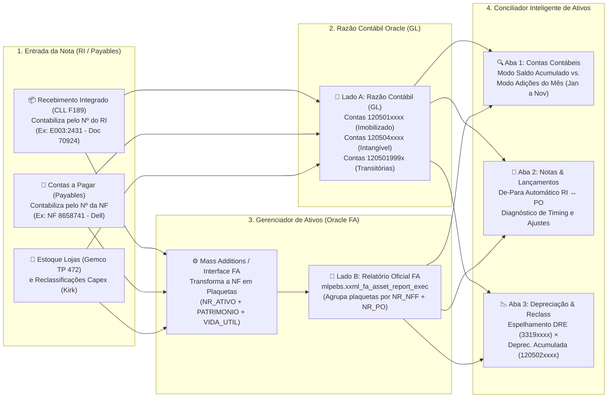

# 🏛️ Conciliador Inteligente de Gestão de Ativos — Hub Contábil CSC (Magalu)

**Automação e Auditoria Contábil-Patrimonial (`Oracle EBS GL` × `Oracle Fixed Assets - FA`)**

[-0f172a?style=for-the-badge)](https://gmmarques07.github.io/conciliador-ativos-magalu/apresentacao_conciliacao_ativos_magalu.html)

---

# 🏛️ Documentação Executiva & Técnica — Conciliador de Gestão de Ativos (Imobilizado, Intangível e Transitórias)

> [!IMPORTANT]
> **Objetivo do Sistema:** Automatizar e auditar **100% da Conciliação Contábil e Patrimonial de Ativos Fixos e Intangíveis** de todas as empresas do grupo Magazine Luiza (`001` a `013`), cruzando diariamente o **Razão Contábil do Oracle EBS (`GL`)** contra o **Gerenciador de Ativos (`Oracle Fixed Assets - FA`)**, do saldo consolidado por Conta Contábil até o nível de **Nota Fiscal (`NR_NFF`), Pedido de Compra (`NR_PO`), Fornecedor e Plaqueta Individual (`NR_ATIVO`)**.

---

## 1. Visão Executiva para Apresentação à Gerência

| Indicador / Escopo Auditado (`11-26`) | Valor / Volume Real (`maga-bigdata`) | Descrição Executiva |
| :--- | :--- | :--- |
| **Patrimônio Bruto Conciliado (Custo FA)** | **R$ 6,16 Bilhões** | Soma das 20+ contas contábeis de Imobilizado, Intangível e Transitórias em todas as empresas do grupo. |
| **Volume de Plaquetas / Bens Ativos** | **4,54 Milhões de itens** | Controle unitário por `NR_ATIVO` e `PATRIMONIO`, amarrado à Nota Fiscal e ao Pedido de Compra (`PO`). |
| **Empresas / Livros de Ativo (`LIVRO_DE_ATIVO`)** | **10 Livros Corporativos** | `001 ML_ATIVO FIXO`, `004 MLOG_ATIVO FIXO`, `005 MPAY`, `006 STOQ`, `007 SBOX`, `008 HUB`, `009 CTEC`, `010 JNRD`, `012 MGC_ATIVO FIXO`, `013 KBUM_ATIVO FIXO`. |
| **Cobertura do Ciclo de Vida do Ativo** | **End-to-End (3 Abas)** | 1. **Saldos & Adições por Conta** · 2. **Notas Fiscais & Divergências** · 3. **Depreciação (DRE × Acumulada) & Reclassificações da Transitória**. |

---

## 2. Arquitetura do Fluxo Contábil e Patrimonial (Como o Conciliador Funciona)

---

## 3. Mapeamento Oficial dos Livros de Ativo (`LIVRO_DE_ATIVO` ↔ `SEGMENT1`)

O seletor de empresas do Conciliador utiliza a nomenclatura oficial dos livros patrimoniais do Oracle Fixed Assets (`FA`):

| Código (`SEGMENT1`) | Livro Oficial no Oracle FA (`LIVRO_DE_ATIVO`) | Empresa / Unidade de Negócio | Destaques Patrimoniais Auditados |
| :---: | :--- | :--- | :--- |
| **`001`** | **`ML_ATIVO FIXO`** | **Magazine Luiza S/A (Lojas, CDs e Matriz)** | R$ 5,65 Bilhões em ativos (`1205040011` Software, `1205010007` Benfeitorias, `1205010004` Móveis, `1205010006` TI). |
| **`004`** | **`MLOG_ATIVO FIXO`** | **Magalog (Logística e Frota)** | R$ 97,5 Milhões em ativos (`1205010007` Benfeitorias CDs, `1205010006` TI/Coletores, `1205010003` Frota). |
| **`005`** | **`MPAY_ATIVO FIXO`** | **Magalupay (Fintech)** | Ativos de tecnologia e terminais financeiros. |
| **`006`** | **`STOQ_ATIVO FIXO`** | **Stoq Tecnologia** | Ativos de PDV e automação comercial. |
| **`007`** | **`SBOX_ATIVO FIXO`** | **Smartbox / Consórcio Magalu** | R$ 18,1 Milhões em Software, Hardware e Imóveis. |
| **`008`** | **`HUB_ATIVO FIXO`** | **Hub Fintech** | Infraestrutura de meios de pagamento. |
| **`009`** | **`CTEC_ATIVO FIXO`** | **Canaltech** | R$ 3,85 Milhões em ativos de Software e Produção. |
| **`010`** | **`JNRD_ATIVO FIXO`** | **Jovem Nerd** | Ativos de mídia e tecnologia. |
| **`012`** | **`MGC_ATIVO FIXO`** | **Magalu Cloud (`Ledger 2042`)** | R$ 397,1 Milhões em Data Centers, Servidores Dell/Ascenty (`1205010006`), Software Cloud (`1205040011`) e IFRS 16 (`1207010001`). |
| **`013`** | **`KBUM_ATIVO FIXO`** | **KaBuM! Comércio Eletrônico** | R$ 143,6 Milhões em Software (`1205040011`), CDs (`1205010007`) e Hardware (`1205010006`). |

---

## 4. Explicação Detalhada das 3 Abas do Conciliador (Guia para Apresentação)

### 4.1. Seletores Superiores (Filtros Dinâmicos)
1. **Período Contábil + Modo de Visão:**
   * **`Acumulado` (Balanço Patrimonial):** Exibe o **Custo Total Histórico** de todos os bens ativos na companhia até aquela data (ex.: R$ 6,16 Bilhões em `11-26`).
   * **`Adições do Mês` (Movimento Mensal):** Filtra exclusivamente as **novas compras e imobilizações ativadas naquele mês específico** (de `Janeiro/2026` a `Novembro/2026`), permitindo bater o movimento líquido mensal do Razão (`Débito − Crédito`) contra as adições do mês no FA.
2. **Empresa (`LIVRO_DE_ATIVO`):** Filtra todas as 3 abas, KPIs e gráficos para a empresa selecionada (`001`, `012`, `004`, `013` ou consolidado).
3. **Grupo Contábil:** Permite isolar **Imobilizado (`120501xxxx`)**, **Intangível (`120504xxxx`)** ou **Contas Transitórias / Em Andamento (`120501999x` / `1205049999`)**.

### 4.2. Aba 1 — `Contas Contábeis`
Lista todas as contas de 10 dígitos (`SEGMENT3`) com:
* **Itens (FA):** Quantidade exata de plaquetas (`NR_ATIVO`) que compõem o saldo.
* **Valor Contábil (GL) × Valor Ativo (FA) × Diferença:** Evidencia ao centavo se a conta está **`Conciliada`** ou se possui **`Divergência`** explicada.
* **Interatividade:** Ao clicar em qualquer conta contábil, a tela filtra automaticamente a **Aba 2 (`Notas & Lançamentos`)** para exibir apenas os documentos daquela conta.

### 4.3. Aba 2 — `Notas & Lançamentos` (Com Gaveta Lateral de Plaquetas)
Exibe a conciliação **Nota a Nota** e **Lote a Lote**, resolvendo o principal desafio operacional da área de Ativos:
* **Resolução Automática da Chave `RI (CLL F189)` × `Pedido (NR_PO)`:**
  * Quando uma nota fiscal entra via **Recebimento Integrado (`ORIGEM = CLL F189 INTEGRATED RCV`)**, o Razão Contábil grava no histórico o **número da operação do RI** (ex.: `E003:2431-Item Doc 70924`), enquanto o Gerenciador de Ativos (`FA`) grava o **número do Pedido de Compra** (`NR_PO = 2535`).
  * O Conciliador cruza automaticamente pelo **Número da Nota Fiscal (`NR_NFF`) + Fornecedor + Valor**, provando que os documentos (`Docs 70924 / 70779`, `Doc 1069`, `Doc 920`, `Docs 430,02 / 485`, `Doc 8709`, `Doc 766`) estão **100% ativados no FA** e exibindo as respectivas plaquetas (`NR_ATIVO 6195605`, `6195606`, `6230881`, `6173601`, `6173600`, `6174603`, `6212881`, `6143268`).
* **Diagnóstico Inteligente das Causas de Divergência Mensal (`GL × FA`):**
  1. **`Timing Recebimento GL × Ativação FA`:** Notas recebidas no almoxarifado/RI no final do mês $M$ (que já debitam o Razão Contábil) mas cuja plaqueta só é gerada no FA no início do mês $M+1$ ou $M+2$ (ex.: notas de `01/2026` da Magalu Cloud ativadas em `03/2026` e `04/2026`).
  2. **`Timing Conta Transitória (1205019999 ↔ 1205010006)`:** Bem ativado inicialmente na conta transitória `1205019999` (`Bens a Imobilizar`) e reclassificado para a conta definitiva `1205010006` (ex.: `R$ 88.743,88` em `07/2026` na empresa `012`).
  3. **`Ajuste de Custo no FA (Lote Adjustment)`:** Ajustes de custo processados diretamente no Gerenciador de Ativos (`ORIGEM = Assets`, `CATEGORIA = Adjustment`, como `R$ 33.651,49` em `05/2026` e `R$ 5.663,67` em `02/2026`).
  4. **`Dízimas de Rateio em Lote`:** Diferenças de `R$ 0,01` a `R$ 0,04` quando uma Nota Fiscal única é dividida em dezenas ou centenas de plaquetas individuais no FA (ex.: `NF 8658794` dividida em 70 notebooks Dell com diferença de `R$ 0,01`).

### 4.4. Aba 3 — `Depreciação & Reclassificações` (100% Dinâmica por Mês, Empresa e Grupo)
1. **Tabela Esquerda — `Espelhamento de Depreciação (DRE × Acumulada)`:**
   * Valida se toda despesa de depreciação lançada no Resultado (**Contas DRE `3319010001`, `3319020005`, `3319010004`**) tem contrapartida idêntica na conta patrimonial de **Depreciação Acumulada (`120502xxxx` / `120505xxxx`)**.
   * No modo **Adições do Mês**, exibe a depreciação gerada pelas safras ativadas naquele período; no modo **Acumulado**, exibe a depreciação total de todas as safras ativas.
2. **Tabela Direita — `Reclassificações da Transitória (1205019999 → Definitiva)`:**
   * Audita a passagem dos bens pela conta transitória até sua ativação na conta definitiva (Equipamentos de TI, Software, Móveis e Benfeitorias), garantindo que o líquido da transferência seja zero.

---

## 5. Fontes de Dados Atuais (BigQuery `D-1`) e Evolução para Conexão Direta Oracle EBS (Fase 2)

| Camada | Fase 1 (No Ar / Homologada — BigQuery `D-1`) | Fase 2 (Próximo Passo — Conexão Direta Oracle EBS) |
| :--- | :--- | :--- |
| **Fonte do Razão Contábil (`GL`)** | `maga-bigdata.gestao_despesas.razao_contabil_mgc` | Tabelas vivas `GL.GL_JE_LINES`, `GL.GL_JE_HEADERS`, `GL.GL_JE_BATCHES` e `GL.GL_CODE_COMBINATIONS` via `python-oracledb`. |
| **Fonte do Ativo Fixo (`FA`)** | `maga-bigdata.mlpebs.xxml_fa_asset_report_exec` *(Corte D-1 do relatório concorrente)* | Tabelas vivas `FA.FA_ADDITIONS_B`, `FA.FA_BOOKS`, `FA.FA_ASSET_INVOICES` e `FA.FA_DEPRN_SUMMARY` em tempo real. |
| **Latência dos Dados** | `D-1` (Última execução do relatório concorrente no Oracle replicada via Kafka). | **Tempo Real (Online / Zero Delay)** — idêntico à consulta direta no PL/SQL Developer. |
